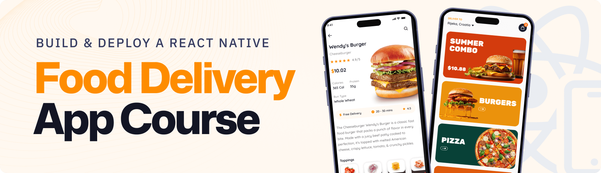

<div align="center">



# 🍲 BongoFoodie v2 — Swahili Gastronomy Platform

**Flagship Flutter Mobile App (`mobile/`) • Next.js 16 Web Storefront, Waiter POS & Admin (`web/`) • Supabase PostgreSQL + Edge Functions (`supabase/`)**

[](./mobile)
[](./web)
[](./supabase)
[](#4-3-layer-supabase-free-tier-never-pause-system)

*Crafted in Kijitonyama, Dar es Salaam, Tanzania 🇹🇿 — built simultaneously as an instant-demo portfolio showcase and a production-ready restaurant ordering & dispatch system.*

</div>

---

## ✨ What’s Inside (Option A Monorepo Architecture)

```text
bongofoodie/
├── mobile/                  # 📱 Flagship Flutter App (Android, iOS & Flutter Web)
│   ├── lib/
│   │   ├── core/            # Theme (Warm Swahili Luxury), EN/SW l10n, EnvConfig, Glass Nav
│   │   ├── data/            # Immutable Models, Showcase Seed Data & Dual Live/Offline Repos
│   │   ├── state/           # Riverpod StateControllers (Auth, Cart, Menu, Live Orders)
│   │   ├── features/        # Onboarding, Auth, Home, Menu, Chef AI, Cart, Profile, Staff POS
│   │   └── router/          # GoRouter 5-tab shell + Staff/Kitchen Dispatch routes
│   ├── assets/              # Quicksand fonts, 35 curated Swahili dish PNGs & SVG icons
│   ├── scripts/             # bootstrap.ps1 (Windows) & bootstrap.sh (macOS/Linux)
│   └── test/                # Pricing, Category Filter, Chef AI & Widget test suite
│
├── web/                     # 🌐 Next.js 16 Customer Storefront + Waiter Dispatch + Admin Portal
│   ├── src/app/             # /, /search, /chef-ai, /cart, /profile, /waiter, /admin
│   ├── src/app/api/         # /api/chef, /api/chef/custom-dish, /api/keepalive (Vercel Cron)
│   └── vercel.json          # Daily Vercel Cron schedule keeping Supabase awake
│
├── supabase/                # 🗄️ Complete Self-Contained Backend (One-Shot SQL + Edge Function)
│   ├── schema.sql           # Full v2 schema: Role RLS, Triggers, Realtime, Storage, TZ Locations
│   ├── migrations/          # Timestamped Supabase CLI migration
│   └── functions/chef-ai/   # Secure Deno Edge Function for Gemini / OpenAI Chef Atelier
│
├── scripts/                 # 🛠️ Node Maintenance & Provisioning Utilities
│   ├── setup-supabase.js    # Seeds Swahili categories, dishes, promos, settings & TZ locations
│   ├── create-admin.js      # Creates or promotes Admin / Waiter staff accounts
│   └── keepalive-ping.js    # Invokes ping_keepalive() RPC for GitHub Actions cron
│
└── .github/workflows/       # ⚙️ Automated CI & Database Heartbeat
    ├── flutter-ci.yml       # Runs flutter analyze, flutter test & web build on PRs/pushes
    └── supabase-keepalive.yml # Pings Supabase every 3 days so Free Tier never pauses
```

---

## 🚀 1. Instant Portfolio Showcase Mode (Zero Keys Needed!)

Both `mobile/` (Flutter) and `web/` (Next.js) run **100% out of the box** even before you create your Supabase project:

- **1-Tap Role Switcher** on Sign-In (`Customer`, `Waiter Dispatch`, or `Restaurant Admin`)
- **12 Authentic Swahili Dishes** (*Nyama Choma & Ugali*, *Pilau ya Kuku wa Kienyeji*, *Samaki wa Kupaka*, *Chipsi Mayai*, *Mishkaki ya Ng’ombe*, *Zanzibar Urojo*, *Stoney Tangawizi*, etc.)
- **Chef Atelier AI** with built-in bilingual Kiswahili/English culinary advisor & orderable **Dream Dish Creator**
- **Cascading Tanzania Locations** (*Dar es Salaam, Arusha, Mwanza, Dodoma, Zanzibar, Kilimanjaro, Mbeya* → Districts → Wards)
- **Lipa Namba & Cash Checkout** with validated promo code (`KARIBU2000`), transparent customization pricing, shareable receipt, and **Live 4-Step Kitchen/Rider Order Tracker**

### Run Next.js Web Locally
```bash
npm --prefix web install
npm --prefix web run dev
```

### Run Flutter Mobile App (`mobile/`)
First time on your machine (generates native `android/`, `ios/`, `web/` platform runners if needed and fetches packages):
```bash
# macOS / Linux
bash mobile/scripts/bootstrap.sh
cd mobile && flutter run

# Windows PowerShell
powershell -ExecutionPolicy Bypass -File mobile\scripts\bootstrap.ps1
cd mobile; flutter run
```

---

## 🔌 2. Plugging In Your New Supabase Project (Step-by-Step)

Once your new Gmail & Supabase project are ready, switching from Showcase Mode to **100% Live Production** takes ~5 minutes:

### Step 1 — Run the One-Shot SQL Schema
1. Open your **Supabase Dashboard → SQL Editor → New Query**.
2. Paste the entire contents of [`supabase/schema.sql`](./supabase/schema.sql) and click **Run**.
   - Creates all 14 tables (`profiles`, `categories`, `menu`, `customizations`, `menu_customizations`, `orders`, `favorites`, `menu_reviews`, `daily_discoveries`, `quiz_attempts`, `promotions`, `settings`, `inventory_alerts`, `regions`/`districts`/`wards`, and `keepalive_heartbeat`).
   - Configures strict **Role-Based Row-Level Security (`customer`, `waiter`, `admin`)** via `public.current_user_role()`.
   - Creates Storage buckets (`food-images`, `dishes`, `avatars`), Realtime on `orders`, rating triggers, and seeds Tanzania Regions/Districts/Wards.

### Step 2 — Seed Menu & Create Your Admin Account
Copy `.env.example` to `.env` in the repo root and fill in your new project credentials:
```env
SUPABASE_URL=https://YOUR_PROJECT_REF.supabase.co
SUPABASE_ANON_KEY=eyJ...
SUPABASE_SERVICE_ROLE_KEY=eyJ...
ADMIN_EMAIL=your-new-email@gmail.com
ADMIN_PASSWORD=StrongPassword123!
```
Then run:
```bash
npm install
npm run supabase:seed
npm run supabase:admin
```

### Step 3 — Connect Web (`web/.env.local` & Vercel)
Create `web/.env.local` (and add the same variables in **Vercel → Project Settings → Environment Variables**):
```env
NEXT_PUBLIC_SUPABASE_URL=https://YOUR_PROJECT_REF.supabase.co
NEXT_PUBLIC_SUPABASE_ANON_KEY=eyJ...
GEMINI_API_KEY=your_optional_gemini_api_key
CRON_SECRET=any_random_secret_string
```

### Step 4 — Connect Flutter (`--dart-define-from-file`)
Copy `mobile/.env.example` to `mobile/.env.json`:
```json
{
  "SUPABASE_URL": "https://YOUR_PROJECT_REF.supabase.co",
  "SUPABASE_ANON_KEY": "eyJ...",
  "WEB_API_BASE_URL": "https://your-vercel-domain.vercel.app"
}
```
Run or build release APK/AAB with:
```bash
cd mobile
flutter run --dart-define-from-file=.env.json
flutter build apk --release --dart-define-from-file=.env.json
```

---

## 🛡️ 3. Key v2 Security & Reliability Upgrades

| Area | Legacy Prototype | BongoFoodie v2 |
| :--- | :--- | :--- |
| **Mobile Stack** | Expo / React Native prototype | **Clean Feature-First Flutter (`mobile/`)** with Riverpod + GoRouter + Material 3 |
| **Menu Security** | Public `UPDATE using (true)` on `menu` | Strict `admin`-only write RLS; `waiter` + `admin` order dispatch RLS |
| **AI API Keys** | Exposed `EXPO_PUBLIC_*` client keys | Server-only Next.js API routes + Supabase `chef-ai` Deno Edge Function |
| **Cart Pricing** | Phantom `-1,000` discount & hidden `+1,000` AI sides | `0` default discount, validated `KARIBU2000`, visible customization chips |
| **Category Filter** | Compared UUID against Category Name after `.limit()` | Matches both ID & Name cleanly before pagination on Mobile & Web |
| **Web Favorites & Orders** | Queried non-existent `menu_items` / `user_id` | Fixed `profile_id` + `menu(*)` relation + customer profile attachment |

---

## 💓 4. 3-Layer Supabase Free-Tier Never-Pause System

Supabase pauses free-tier projects after 7 days of database inactivity. BongoFoodie prevents this with three independent layers:

1. **GitHub Actions Cron (`.github/workflows/supabase-keepalive.yml`)**: Runs every 3 days (`0 8 */3 * *`) and executes `public.ping_keepalive()` (real PostgreSQL write + read). Add `SUPABASE_URL` and `SUPABASE_ANON_KEY` under **GitHub Repo → Settings → Secrets and variables → Actions**.
2. **Vercel Daily Cron (`web/vercel.json` → `/api/keepalive`)**: Pings Supabase daily at `06:00 UTC` — continues running even if the GitHub repository has no new commits for 60+ days.
3. **Resilient Showcase Fallback**: Even when offline or before keys are configured, every screen on Mobile and Web gracefully serves curated Tanzanian culinary data with zero crashes.

---

## 📄 License

MIT © BongoFoodie Dar es Salaam
